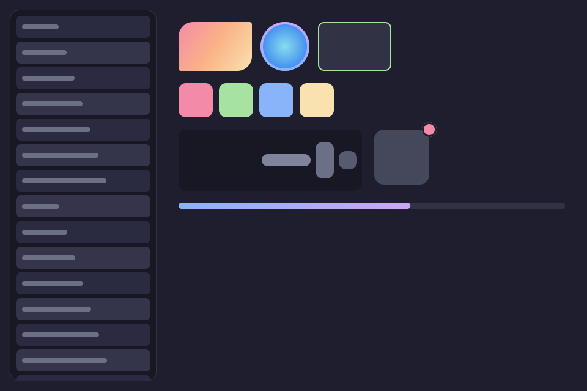

# octlui

A retained-state, GPU-rendered UI library for Rust with a [gpui](https://gpui.rs)-inspired API:
declarative node trees returned from a view function, actions bound to keys through key
contexts, and typed listeners. Pure Rust: `winit 0.31` for windowing, `wgpu` for rendering.



## A taste

```rust
use octlui::{style::*, *};

struct State { value: i32 }

#[octlui::action]
struct Reset;

#[octlui::action]
struct Change { amount: i32 }

fn reset(state: &mut State, cx: &mut Context<State>, _: Reset) {
    state.value = 0;
    cx.notify();
}
fn change(state: &mut State, cx: &mut Context<State>, action: &Change) {
    state.value += action.amount;
    cx.notify();
}

fn view(state: &mut State, cx: &mut Context<State>) -> Node {
    node()
        .key_context("counter")
        .on_action(cx.listener(reset))     // handler may take the action by value...
        .on_action(cx.listener(change))    // ...or by reference
        .child(node().size(fixed(64.0), fixed(64.0)).background(0xa6e3a1)
            .on_click_action(Change { amount: 1 }))
}

fn main() {
    application().run(|acx: &mut AppContext| {
        acx.bind_keys([KeyBinding::new(Key::R, Reset, Some("counter"))]);
        acx.open_window(WindowOptions::new(), State { value: 0 }, view);
    });
}
```

Run the examples with `cargo run --example counter` and `cargo run --example showcase`.

## Concepts

**Views and state.** `acx.open_window(options, state, view)` owns your state `S`. `view` runs
again whenever a handler calls `cx.notify()` (or the window changes); between those it is not
called, and animations/scrolling run without it.

**Listeners.** `cx.listener(f)` turns `fn(&mut S, &mut Context<S>, &E)` *or*
`fn(&mut S, &mut Context<S>, E)` into a handler; `E` is inferred. Node handlers: `on_click`,
`on_mouse_down`, `on_hover`, `on_key_down`, `on_file_drop`, `on_action`, plus
`on_click_action(action)`. `Context` also offers `dispatch`, `focus`, `blur`, `set_title`,
`quit`, `is_hovered`, `is_focused`.

**Actions.** `#[octlui::action]` on a struct/enum (adds `Clone + Debug` if missing). Actions
dispatch from the focused node (or the root) up to the root; the first node with a matching
`on_action` handles it. Unhandled actions go to `acx.on_action::<A>(..)` global handlers.

**Key bindings.** `KeyBinding::new(Key::S.with(Modifiers::primary()), Save, Some("editor && !readonly"))`.
Contexts are the `key_context` names along the focus path; deeper matches win, later bindings
win ties. `Keystroke::parse("ctrl-shift-s")` is available too.

**Focus.** `.focusable(true)` nodes take focus when clicked (or via `cx.focus(id)`).

## Node

Always present: `width`/`height` (`fit()`, `grow()`, `fixed(x)`, `fraction(f)` each with
`.min(..)`/`.max(..)`), `child_align_x`/`child_align_y` (`Start|Center|End`), `direction`
(`TopToBottom|BottomToTop|LeftToRight|RightToLeft`), `child_gap`.

Optional: `id`, `padding`, `corner_radius` (per corner), `aspect_ratio`, `clip`
(`None|X|Y|XY`), `key_context`, `focusable`, `on_file_drop`.

Optional components (each boxed, so plain nodes stay small):

| component | what it does |
|---|---|
| `Appearance` | background + border (width, color); colors may be gradients (`Fill::linear`, `Fill::radial`, up to 8 stops) |
| `Text` | content, color (gradient ok), size, font, alignment, wrap: `None / Letters / Words / NewLines / Clip { ellipsis } / Fade { length }` |
| `Image` | `ImageId` source, tint (gradient ok), fit `Contain / Cover / Fill / None`; drawn above the background, below text |
| `Tooltip` | a `Node` shown after a hover delay, with fade in/out |
| `Scroll` | child offset, smooth scrolling, wheel/track pad, optional `ScrollBar` (radius, colors, reserve space, side, always-visible or fading, thickness, draggable thumb) |
| `Floating` | lifts the node out of the flow, attached to its parent via two anchors + offset, optional clip to parent, z-index |
| `Spring` | chosen properties (`POSITION`, `SIZE`, `BACKGROUND`, `BORDER`, `TINT`, `TEXT_COLOR`) lag behind declared values; stiffness/damping/mass/precision |

### Builder macros

`Node` and every component are declared with the same macros you can use for your own types:

```rust
#[derive(Default)]
#[octlui::builder]              // generates `Self::counter_config()`
pub struct CounterConfig {
    #[octlui::property]
    step: i32,                  // pub fn step(self, i32) -> Self
    #[octlui::property]
    limit: Option<i32>,         // pub fn limit(self, i32) -> Self   (stores Some)
    #[octlui::property(into)]
    label: String,              // pub fn label(self, impl Into<String>) -> Self
}
```

Options: `#[builder(free)]` also emits a free function (`node()`), `#[builder(name = "new")]`
renames the constructor, `#[builder(no_constructor)]` skips it. Property options: `into`,
`boxed` (for `Option<Box<T>>`, setter takes `T`), `name = "..."`.

## Architecture

```
view() -> Node tree
  └─ Arena::build        BFS-flattened, children contiguous, parents before children
      └─ layout          fit W → grow/shrink W → fit H (text wraps) → grow/shrink H → position
          └─ tick        scroll smoothing, scroll-bar fades, springs, tooltip timers
              └─ paint   RenderList (quads, images, text runs) + hit regions + scroll-bar hits
                  └─ Renderer (wgpu)   one instanced draw per image batch
```

* Layout passes are plain loops over a contiguous arena (reverse = bottom-up, forward =
  top-down); no recursion, no per-node allocation.
* One shader draws everything: SDF rounded rectangles with per-corner radii, anti-aliased
  borders, gradient fills (storage buffer), image sampling with tint, and a **per-instance clip
  rect** (so clipping never breaks batches). Consecutive solid quads are a single draw call.
* Retained per-node state (scroll offsets, springs, fades, tooltip timers) is keyed by `Id`
  (or by tree position when no id is given). Give list items stable ids.
* Springs are visual only: `POSITION` translates the node's whole subtree, `SIZE` changes the
  node's own background/border/image; layout and hit-testing of children use declared values.
* Coordinates are logical pixels; the renderer applies the window scale factor. Colors are
  sRGB values blended in gamma space (a non-sRGB surface format is preferred).
* `headless::HeadlessRenderer` renders to RGBA offscreen for screenshot tests.

## Text

Windowed and headless renderers use the system sans-serif font by default. Use
`components::FontId::SERIF` or `MONOSPACE` to select another system family.
Layout uses the selected face's advances and line metrics in logical pixels.
The renderer rasterizes glyphs at the window's physical scale through DirectWrite
on Windows, Core Graphics on macOS, and FreeType on Linux. Coverage masks stay in
GPU atlas pages across frames. Consecutive glyphs on one page share an instanced draw.

The built-in layout maps individual Unicode characters to glyphs. Complex-script
shaping, bidirectional layout, and fallback across font families require a custom
`TextMeasurer` and `TextRenderer`. Install them with `AppContext::set_text_measurer`
and `AppContext::set_text_renderer`.

## Images

`acx.images().insert_rgba(w, h, pixels)` returns an `ImageId`; or register an
`ImageSupplier` that loads by id on demand. octlui contains no image decoders.

## Platform notes

* File drops use winit 0.31's data-transfer API (`UriList`); `FileDropEvent` carries paths.
* Requires a Rust toolchain recent enough for `winit 0.31.0-beta.4` and `wgpu 30`.
* Tests: `cargo test` (GPU tests skip if no adapter is found; CI uses lavapipe).

## License

MIT OR Apache-2.0
